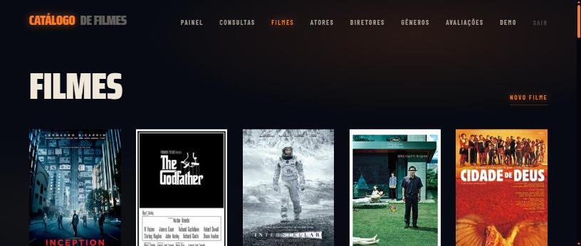
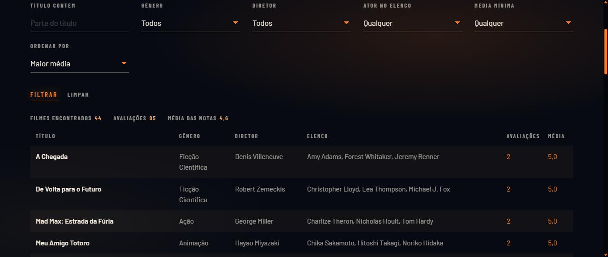
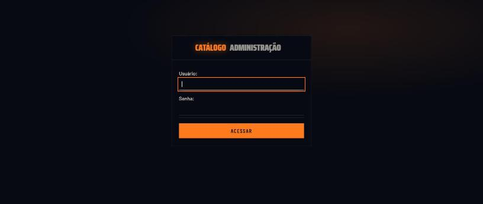
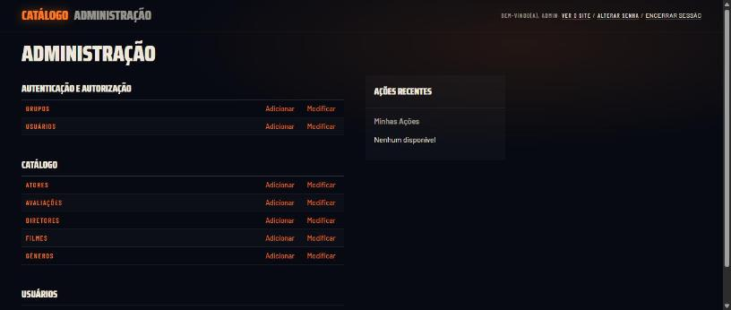
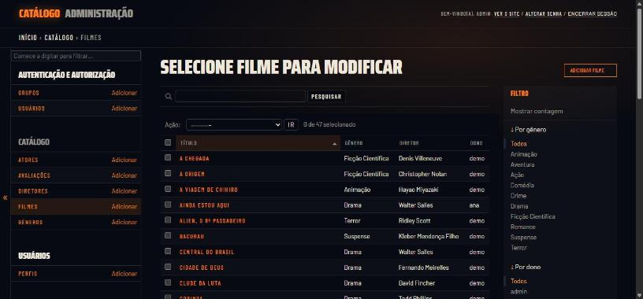
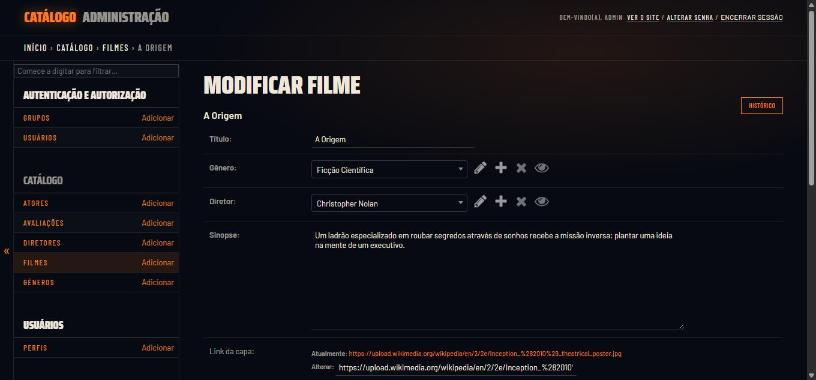

# Catálogo de Filmes

Filmoteca pessoal em Django: cada usuário cadastra os próprios filmes, monta o elenco, dá notas e acompanha tudo num painel. São **7 models** em **2 apps**, com relações **1:N, 1:1 e N:N com tabela intermediária**, login obrigatório nas áreas internas e isolamento de dados por usuário.

Continuação dos trabalhos anteriores (2 models → 4 models → versão final).

## Como ficou

**Início** (público): parede de cartazes e a chamada para entrar.


**Painel**: o filme de maior média em destaque, com as contagens do catálogo logo abaixo.


**Filmes**: grade de capas reais, buscadas na Wikipédia.



**Página do filme**: nota, sinopse, ações, elenco, avaliações e onde assistir.


**Consultas**: filtros por título, gênero, diretor, ator e média, com exportação em CSV.



**Exclusão bloqueada**: o `PROTECT` explicado, sem tela de erro.


**Admin** (`/admin/`): o painel do Django com o mesmo visual do site.









## Stack

- Django 5.2
- SQLite (padrão do Django)
- HTML/CSS puro, sem frameworks front-end

## Rodar em um comando (Windows)

Dê dois cliques em **`rodar.bat`** ou, no terminal, dentro da pasta do projeto:

```bat
rodar.bat
```

O script faz tudo em sequência:

1. cria o ambiente virtual, se ainda não existir;
2. instala as dependências do `requirements.txt`;
3. aplica as migrations, que já criam e populam o banco (contas, filmes, elenco, avaliações e capas);
4. roda os testes;
5. abre o navegador e sobe o servidor em `http://127.0.0.1:8000/`.

Só precisa do Python instalado e de internet para as capas. Rodar de novo não apaga nada: as migrations de seed só acrescentam o que falta. Para parar o servidor, `Ctrl+C`.

## Instalação manual

```bash
# 1. Criar e ativar o ambiente virtual
python -m venv venv
venv\Scripts\activate      # Windows
source venv/bin/activate   # Linux/Mac

# 2. Instalar as dependências
pip install -r requirements.txt

# 3. Aplicar as migrations (o seed já popula todas as tabelas)
python manage.py migrate

# 4. Rodar o servidor
python manage.py runserver
```

A aplicação abre em `http://127.0.0.1:8000/`.

### Contas prontas

As migrations de seed criam as contas abaixo. 

| Usuário | Senha | O que tem |
|---|---|---|
| `demo` | `filmes123` | 44 filmes com capa, pelo menos 3 atores no elenco de cada um, 95 avaliações e perfil preenchido |
| `ana` | `filmes123` | outro catálogo, de 3 filmes (Oppenheimer, Ainda Estou Aqui, O Menino e a Garça) |
| `admin` | `filmes123` | superusuário, para o `/admin/` |

Entrar como `demo` e depois como `ana` mostra o isolamento na prática: cada conta vê só os próprios filmes e avaliações, mas as duas usam os mesmos gêneros, diretores e atores (Fernanda Montenegro está no catálogo das duas). Uma conta nova, em **Criar conta**, começa com o catálogo vazio.

### Roteiro sugerido para a apresentação

1. **Início** (`/`): a vitrine pública, com a parede de cartazes.
2. Entrar como `demo` e abrir o **Painel**: contagens, maior média, últimos filmes e avaliações.
3. **Filmes** → abrir um filme: nota, distribuição das notas, elenco, onde assistir e mais filmes do mesmo diretor.
4. Criar, editar e excluir em qualquer CRUD. Tentar excluir um gênero ou diretor com filmes mostra o bloqueio explicado (`PROTECT`).
5. **Consultas**: filtrar por gênero, diretor, ator ou nota e exportar o CSV.
6. Sair e entrar como `ana` para mostrar o isolamento. Abrir `/admin/` com `admin`.

### Capas dos filmes

Os 47 filmes do seed já vêm com o link do pôster (exibido direto da Wikimedia, então precisa de internet; sem ela, aparece a capa desenhada). As telas carregam a miniatura de 330px da Wikimedia, três vezes mais leve; se ela falhar, a página tenta o arquivo original. Para filmes novos:

- na página do filme, clique em **Buscar capa automaticamente**; ou
- cole o endereço de uma imagem no campo **Link da capa** ao editar; ou
- preencha todos de uma vez: `python manage.py buscar_capas` (use `--usuario demo` para um usuário só e `--todos` para refazer quem já tem capa).

### Onde assistir

A página de cada filme tem atalhos que abrem a busca do título no Netflix, Prime Video, Max, Globoplay e Apple TV, além do JustWatch, que mostra em qual serviço o filme está disponível no Brasil. O sistema não afirma disponibilidade, porque não existe API pública e gratuita para isso e o catálogo dos serviços muda com frequência.

### Testes

```bash
python manage.py test
```

São 33 testes em `catalogo/tests.py`: acesso público e restrito, isolamento entre usuários, dashboard, CSV, relacionamentos, capas, onde assistir e segurança (limite de tentativas no site e no admin, CSP, CSV sem fórmula, filtros sem dado de outra conta, vitrine só com capas da Wikimedia e corridas no banco). O CI do GitHub roda os mesmos testes em todo PR, junto com `pip-audit`, `makemigrations --check` e `check --deploy`. A classe `ProntoParaApresentarTeste` confere que um banco criado só com `migrate` já vem pronto: contas `demo`, `ana` e `admin`, elenco em todos os filmes e as páginas principais abrindo.

## Apps

| App | Responsabilidade |
|---|---|
| `usuarios` | login, logout, cadastro e perfil (model `Perfil`) |
| `catalogo` | entidades de negócio: filmes, elenco, diretores, gêneros, avaliações, painel e consultas |

`core/` é o pacote de configuração do projeto (`settings.py`, `urls.py`), não um app.

## Modelo de dados

```
                 User ──1:1── Perfil ──N:1── Genero (favorito)
                  │
                  │ 1:N (dono)
                  ▼
Genero ──1:N──┐
              ├──> Filme ──1:N──> Avaliacao <── 1:N ── User
Diretor ─1:N──┘      │
                     │ N:N through Elenco (personagem, ordem)
                     ▼
                    Ator
```

### Relacionamentos

| Tipo | Relação | Como está no código |
|---|---|---|
| **1:1** | `User` ↔ `Perfil` | `Perfil.usuario = OneToOneField(User)` |
| **1:N** | `Genero` → `Filme` | `Filme.genero = ForeignKey(Genero, PROTECT)` |
| **1:N** | `Diretor` → `Filme` | `Filme.diretor = ForeignKey(Diretor, PROTECT)` |
| **1:N** | `Filme` → `Avaliacao` | `Avaliacao.filme = ForeignKey(Filme, CASCADE)` |
| **1:N** | `User` → `Filme` / `Avaliacao` | campo `usuario` (dono do registro) |
| **N:N com through** | `Filme` ↔ `Ator` | `Filme.atores = ManyToManyField(Ator, through='Elenco')` |

### Os models

| Model | App | Campos principais |
|---|---|---|
| `Perfil` | usuarios | usuario (1:1), apelido, bio, genero_favorito, criado_em |
| `Genero` | catalogo | nome (único) |
| `Diretor` | catalogo | nome, nacionalidade |
| `Ator` | catalogo | nome, nacionalidade |
| `Filme` | catalogo | titulo, genero, diretor, sinopse, capa_url, atores, usuario |
| `Elenco` | catalogo | filme, ator, personagem, ordem — único por (filme, ator) |
| `Avaliacao` | catalogo | filme, autor, nota (1–5), comentario, criado_em, usuario |

### `on_delete`

- `PROTECT` em `Filme.genero`, `Filme.diretor` e `Elenco.ator`: tabelas de referência não podem sumir enquanto houver filme ligado a elas. A interface explica o bloqueio em vez de dar erro.
- `CASCADE` em `Avaliacao.filme` e `Elenco.filme`: avaliação e participação só existem em função do filme.
- `SET_NULL` em `Perfil.genero_favorito`: apagar um gênero não apaga o perfil de ninguém.

## Segurança

- **Área pública vs. restrita:** só a Home (`/`), `/login/` e `/cadastro/` abrem sem login. Todas as outras views têm `@login_required(login_url='login')`, e `LOGIN_URL = 'login'` está no `settings.py`. Quem tenta abrir uma tela interna é mandado para `/login/?next=...` e volta para ela depois de entrar.
- **Isolamento de dados:** toda consulta de `Filme`, `Avaliacao` e `Elenco` parte de `request.user` (funções `filmes_do`, `avaliacoes_do` e `elenco_do` em `catalogo/views.py`), inclusive as buscas por `pk`. Um id de outro usuário digitado na URL retorna 404. O dono é gravado a partir da sessão no `save`, nunca a partir do formulário, e o `AvaliacaoForm` só aceita filmes do próprio usuário.
- **CSRF:** todos os formulários POST têm ``, inclusive o botão **Sair** (no Django 5 o logout é por POST).
- **Limite de tentativas:** 5 senhas erradas ou 5 contas criadas pelo mesmo IP bloqueiam por 15 minutos (`usuarios/limite.py`). Vale também para o login do `/admin/`. Rodando local, todo acesso vem de `127.0.0.1` e divide o mesmo contador: se o bloqueio aparecer durante a apresentação, `Ctrl+C` e `rodar.bat` de novo zeram tudo.
- **Senhas:** guardadas como hash `pbkdf2_sha256` com salt e 1.000.000 de iterações (padrão do Django), inclusive as das contas do seed.
- **Cabeçalhos:** `Content-Security-Policy` em todas as respostas (`core/middleware.py`); em produção, também HTTPS obrigatório, cookies `Secure` e HSTS.
- **Segredos:** `SECRET_KEY` e `DEBUG` vêm do ambiente. Sem variável nenhuma, o projeto roda em modo de desenvolvimento. Para produção:

  ```bash
  DJANGO_DEBUG=0
  DJANGO_SECRET_KEY=<python -c "import secrets; print(secrets.token_urlsafe(50))">
  DJANGO_ALLOWED_HOSTS=meudominio.com
  ```

  Antes de publicar, troque as senhas das contas do seed (`python manage.py changepassword admin`).

A revisão completa pelo checklist de segurança está em [AUDITORIA.md](AUDITORIA.md).

Gênero, Diretor e Ator são tabelas de referência compartilhadas (o mesmo "Drama" serve para todos), mas os filmes exibidos dentro delas também passam pelo filtro do usuário. Ver [DECISOES.md](DECISOES.md), item 26.

## Telas

| URL | Acesso | Descrição |
|---|---|---|
| `/` | público | vitrine: parede de cartazes animada, uma frase e a ação de entrar |
| `/login/`, `/cadastro/` | público | autenticação, com a mesma parede de cartazes ao fundo |
| `/perfil/` | restrito | edição do perfil (1:1) |
| `/dashboard/` | restrito | indicadores do usuário: totais, média geral, filmes por gênero, destaque, últimos filmes e avaliações |
| `/consultas/` | restrito | filtros (título, gênero, diretor, ator, média mínima, ordenação) e **exportação CSV** do resultado |
| `/filmes/` | restrito | CRUD de filmes; o detalhe tem nota, distribuição das notas, elenco, onde assistir e outros filmes do diretor |
| `/atores/` | restrito | CRUD de atores (a lista mostra quem está no seu catálogo e quem ainda não tem filme) |
| `/diretores/` | restrito | CRUD de diretores |
| `/generos/` | restrito | CRUD de gêneros |
| `/avaliacoes/` | restrito | CRUD de avaliações |
| `/admin/` | staff | painel administrativo do Django, com o visual do site (`templates/admin/`, `catalogo/static/catalogo/admin.css`) |

Os CRUDs seguem o mesmo padrão de rotas: `/`, `/novo/`, `/<pk>/`, `/<pk>/editar/` e `/<pk>/excluir/`. Todos os formulários são `ModelForm`, menos o de filtros da consulta, que é um `Form` comum porque não grava nada.

## Organização do código

```
core/                        configurações e rotas do projeto
  middleware.py              Content-Security-Policy
usuarios/
  limite.py                  limite de tentativas no login e no cadastro
  models.py                  Perfil (1:1 com User)
  signals.py                 cria o Perfil de todo usuário novo
  forms.py                   CadastroForm, PerfilForm
  views.py                   cadastro e perfil (login/logout são as views do Django)
  templates/usuarios/        login.html, cadastro.html
catalogo/
  models.py                  Genero, Diretor, Ator, Filme, Elenco, Avaliacao
  forms.py                   um ModelForm por model + ConsultaForm
  views.py                   home, painel, consultas/CSV, os CRUDs e os links de onde assistir
  capas.py                   busca do pôster na Wikipédia
  templatetags/vitrine.py    a parede de cartazes do início, do login e do cadastro
  management/commands/       buscar_capas (preenche as capas em lote)
  tests.py                   testes automatizados
  migrations/
    0002, 0003               seed de gêneros, diretores, filmes e avaliações
    0004_dono_dos_registros  cria a conta demo e dá dono ao seed
    0006_seed_elenco         atores e elenco de exemplo
    0008_seed_capas          links dos pôsteres dos filmes do seed
    0009_conta_admin         superusuário admin
    0010_seed_completo       elenco completo, perfil da demo e a conta ana
    0011_mais_filmes_demo    mais 24 filmes na demo, com elenco, capa e avaliações
  static/catalogo/style.css  todo o visual (HTML e CSS puros, sem build)
  templates/catalogo/
    base.html                layout e navegação (muda com o login)
    home.html                vitrine pública
    filme_detalhe.html       página do filme
    form.html                formulário compartilhado por todos os ModelForms
    confirmar_exclusao.html  confirmação compartilhada
templates/admin/             base_site.html: veste o /admin/ com o visual do site
docs/telas/                  prints das telas usados neste README
rodar.bat                    prepara e sobe tudo em um comando
```

## Decisões de projeto

As escolhas de modelagem e arquitetura, com as alternativas descartadas, estão em [DECISOES.md](DECISOES.md). O sistema visual está documentado em [DESIGN.md](DESIGN.md).
